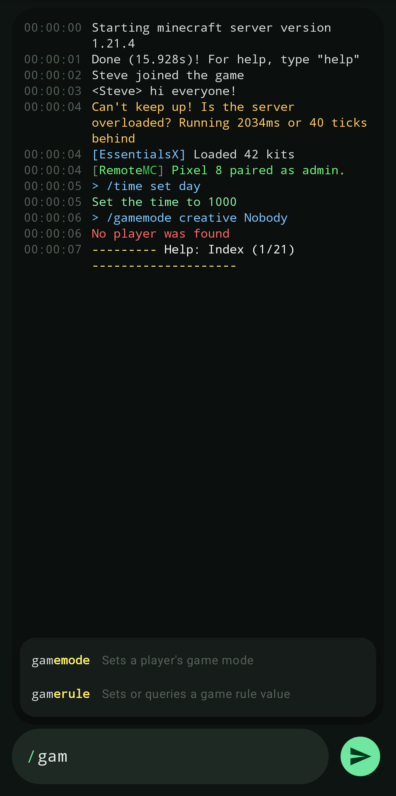
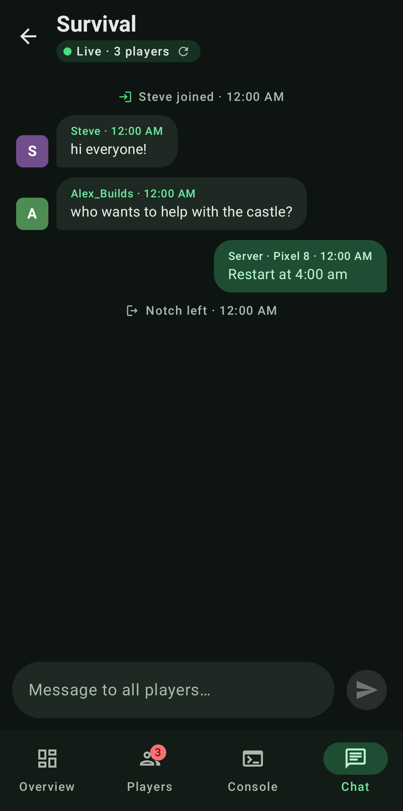
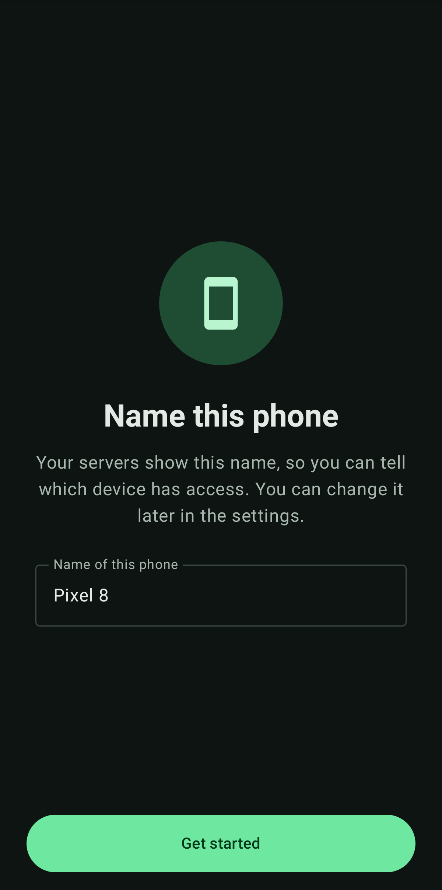
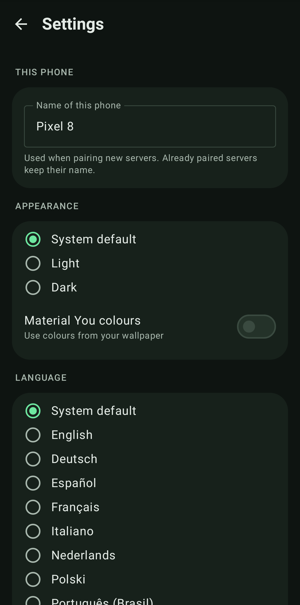

# RemoteMC

Verwalte deinen Minecraft-Server vom Handy aus – live, verschlüsselt und kostenlos.
**[English version](README.md)** (dort auch API-Referenz und Entwickler-Infos)

  
  
  
  

  
  
  
  

## Einrichtung
1. **Plugin:** `RemoteMC-x.y.z.jar` aus den [Releases](https://github.com/michig-code/RemoteMC/releases) in den
   `plugins/`-Ordner legen und den Server neu starten (Paper, Purpur, Folia oder Spigot ab 1.20.6).
2. **Port:** TCP-Port **8765** in Firewall/Router freigeben – oder in `plugins/RemoteMC/config.yml` unter
   `api.port` einen Zusatzport deines Hosters eintragen und `/remotemc reload` ausführen.
3. **App:** `RemoteMC-App-x.y.z.apk` aus den Releases installieren.
4. **Koppeln:** `/remotemc pair` im Spiel oder in der Konsole eingeben und den QR-Code scannen
   (im Spiel erscheint er auf einer Karte). Ohne Kamera: „Code eingeben“ und Adresse, Port und Code eintippen.

> Umstieg von dem McRemote-Prototyp: `McRemote-1.0.0.jar` löschen – RemoteMC übernimmt Config und Token automatisch.
> Für Deutsch in den Plugin-Meldungen `language: de` in der Config setzen (außerdem: es, fr, it, nl, pl, pt-BR, tr, ru).

## Befehle (Recht `remotemc.admin`, Standard: OP, Kurzform `/rmc`)
| Befehl | Beschreibung |
|---|---|
| `/remotemc pair [admin\|moderator\|viewer]` | Einmal-Code + QR-Code für die App |
| `/remotemc info` | Status, Port, Zertifikat, gekoppelte Geräte |
| `/remotemc token create <name> [rolle]` | Token für Skripte oder manuelle Einrichtung |
| `/remotemc token list` / `revoke <name>` | Geräte anzeigen / Zugang entziehen |
| `/remotemc reload` | Config neu laden |

**Rollen:** *viewer* sieht Status, Spieler und Chat · *moderator* zusätzlich Konsole lesen, chatten, Spieler
kicken/bannen/heilen · *admin* zusätzlich Konsolenbefehle und OP.

## Sicherheit
Die Verbindung ist per HTTPS verschlüsselt; die App vertraut genau dem Zertifikat aus dem QR-Code. Jedes Handy
bekommt einen eigenen Zugang, der Server speichert nur Hashes. Alle Aktionen landen in `plugins/RemoteMC/audit.log`.
