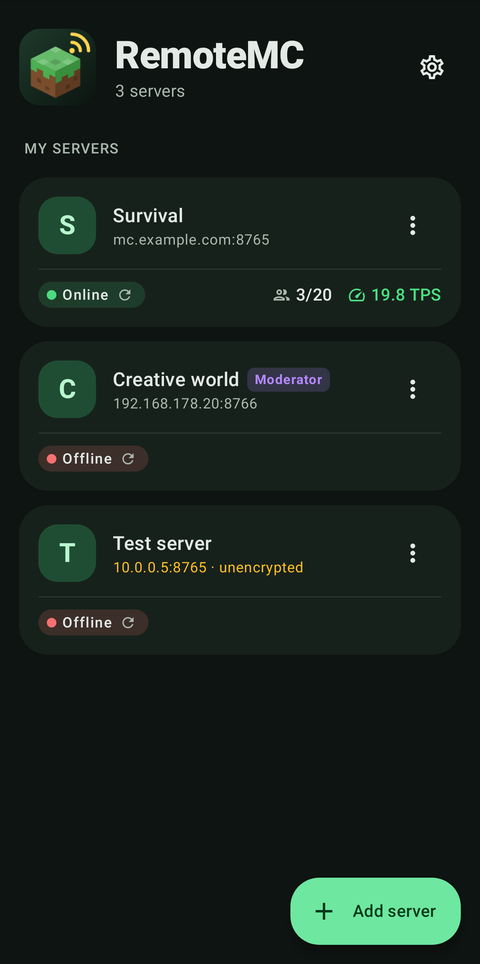
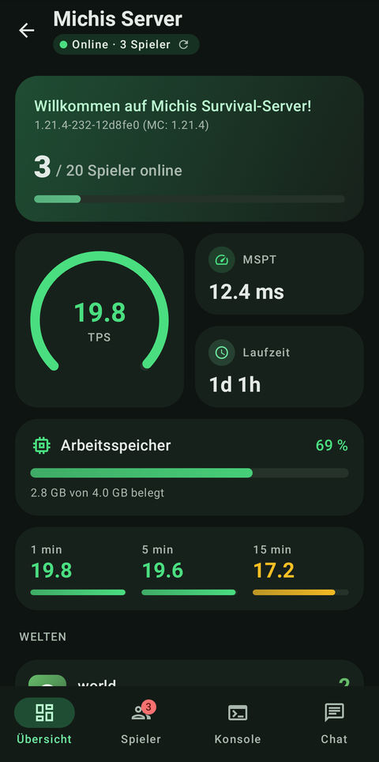
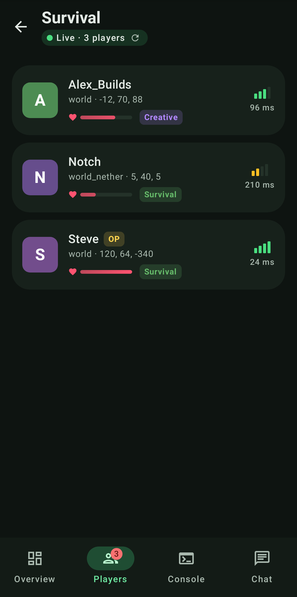
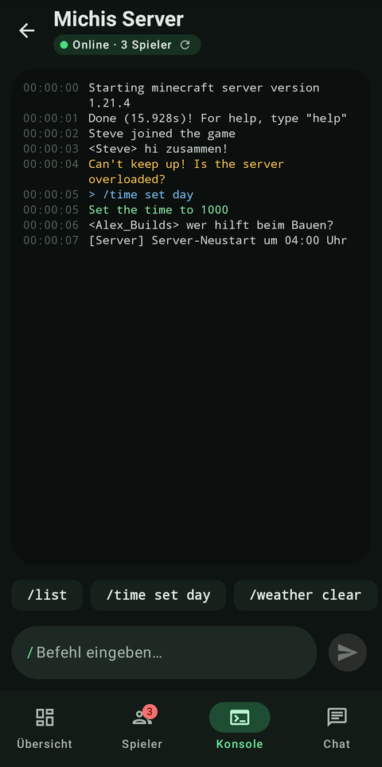
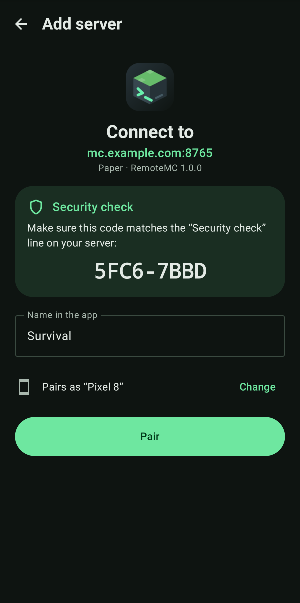

# RemoteMC

Manage your Minecraft server from your phone – live, encrypted and free.
**[Deutsche Version](README.de.md)**

| Folder | What it is |
|---|---|
| [`plugin/`](plugin) | Server plugin for Paper, Purpur, Folia and Spigot (Minecraft 1.20.6 – 26.x) |
| [`android-app/`](android-app) | Android app (Android 8+, Kotlin / Jetpack Compose) |

<p>
  
  
  
  
  
</p>

## Features
- **Dashboard** – TPS gauge, MSPT, memory, uptime, TPS history and worlds, updated live
- **Players** – heads, health, ping and location; message, heal, game mode, OP, kick, ban; search and sort
- **Console** – coloured live server log, commands with their output, suggestions while typing
  (from the server's own tab completion) and your recently used commands
- **Chat** – chat, joins and leaves as they happen; broadcast with undo
- **Pairing in seconds** – `/remotemc pair` shows a QR code on an in-game map or in the console
- **Security** – built-in HTTPS with certificate pinning, one token per device (stored hashed on the
  server, encrypted in the Android Keystore on the phone), roles, lockout, audit log
- **Polish** – light/dark theme, Material You, tablet layout, English & German, haptics, accessibility

## Quick start
1. **Plugin:** download `RemoteMC-x.y.z.jar` from the [releases](https://github.com/michig-code/RemoteMC/releases),
   put it into `plugins/` and restart the server.
2. **Port:** open TCP port **8765** in your firewall/router (or set `api.port` to an extra port your host gives you).
3. **App:** install `RemoteMC-App-x.y.z.apk` from the releases (allow “install unknown apps”).
4. **Pair:** run `/remotemc pair` in game or in the console and scan the QR code with the app.
   Without a camera: tap “Enter code” and type the address, port and 6-digit code.

> Upgrading from McRemote 1.x? Remove `McRemote-1.0.0.jar`. RemoteMC takes over its config and token on first start.

## Commands
Permission `remotemc.admin` (default: OP), alias `/rmc`.

| Command | Description |
|---|---|
| `/remotemc pair [admin\|moderator\|viewer]` | One-time pairing code + QR code (default role: admin) |
| `/remotemc info` | API status, port, certificate fingerprint, paired devices |
| `/remotemc token create <name> [role]` | Token for scripts or manual setup (shown once) |
| `/remotemc token list` | Paired devices and when they were last used |
| `/remotemc token revoke <name>` | Revoke a device's access |
| `/remotemc reload` | Reload `config.yml` |

### Roles
| Role | Can |
|---|---|
| viewer | see status, players and chat |
| moderator | + read the console, chat, message / heal / game mode / kick / ban players |
| admin | + run console commands, OP / DeOP |

## Configuration (`plugins/RemoteMC/config.yml`)
```yaml
language: en              # en, de
api:
  host: 0.0.0.0
  port: 8765
  public-address: ""      # domain/IP for QR codes; empty = server-ip or LAN address
  tls: true               # built-in HTTPS; only disable behind your own HTTPS reverse proxy
security:
  max-failed-attempts: 5
  lockout-seconds: 300
  pairing-code-minutes: 5
  allow-commands: true
  blocked-commands: [stop, restart]
console:
  buffer-size: 500
audit-log: true
update-check: true
```

## Security
- Traffic is encrypted with TLS. The plugin creates its own certificate (`tls.p12`); the QR code contains
  its SHA-256 fingerprint, so the app trusts exactly that certificate. When pairing by hand, the app shows a
  short code (e.g. `AB12-CD34`) to compare with the server console.
- Each phone gets its own token. The server stores only hashes; revoke a phone with `/remotemc token revoke`.
- If the certificate ever changes, the app refuses to connect and asks you to pair again.
- Access tokens, open pairing codes and console QR codes are hidden from the console stream, so a
  moderator cannot read an admin's credentials there.
- Deleting `tls.p12` creates a new certificate – all devices then have to pair again.
- Behind a reverse proxy, all requests come from the proxy's IP; the lockout then applies to everyone.

## Compatibility
Tested with the end-to-end suite in [`plugin/integration-test`](plugin/integration-test):

| Server | Result |
|---|---|
| Paper 1.20.6 | ✅ all API and player checks |
| Paper 1.21.4 | ✅ all API and player checks |
| Paper 26.3 (Java 25) | ✅ all API checks |
| Folia 1.21.4 | ✅ all checks; TPS is not reported (Folia ticks per region) |
| Spigot 1.21.4 | ✅ all checks; no TPS, command output appears in the console stream |

## API
JSON over HTTPS, `Authorization: Bearer <token>`. Errors are `{"error": "<code>", "message": "…"}`.

| Method | Path | Role | Description |
|---|---|---|---|
| GET | `/api/v1/ping` | – | Plugin version and API version |
| POST | `/api/v1/pair` | – | `{"code","device"}` → `{"token","name","role"}` |
| GET | `/api/v1/me` | viewer | Name and role of this token |
| GET | `/api/v1/status` | viewer | TPS, MSPT, memory, players, worlds |
| GET | `/api/v1/players` | viewer | Online players |
| GET | `/api/v1/chat?since=<id>` | viewer | Chat, joins and leaves |
| GET | `/api/v1/events` | viewer | Server-Sent Events: `hello`, `status`, `chat`, `console` (moderator+) |
| GET | `/api/v1/console?since=<id>` | moderator | Console lines |
| POST | `/api/v1/chat` | moderator | `{"message"}` broadcast |
| POST | `/api/v1/players/<name>/<action>` | moderator | `kick`, `ban` (`reason`), `heal`, `gamemode` (`mode`), `message` (`message`); `op`/`deop` need admin |
| POST | `/api/v1/command` | admin | `{"command"}` → `{"success","output","formatted"}` (formatted keeps `§` colour codes) |
| GET | `/api/v1/commands` | admin | Commands the console can run (name, description, usage, aliases) |
| GET | `/api/v1/complete?buffer=<text>` | admin | Tab completion, e.g. `gamemode cr` → `["creative"]` |

## Development
```bash
cd plugin && mvn package                      # plugin + unit tests → target/RemoteMC-*.jar
cd android-app && ./gradlew lintDebug testDebugUnitTest assembleRelease
./gradlew testDebugUnitTest -Proborazzi.test.record=true   # update screenshots after UI changes
```
CI (`.github/workflows/build.yml`) runs unit tests, an end-to-end test against a real Paper server,
Android lint and a screenshot comparison.

### Releasing
Push a tag like `v2.0.1`. The release workflow builds both parts, creates a GitHub release and – if
configured – publishes the plugin to Modrinth and Hangar.

| Secret / variable | Purpose |
|---|---|
| `RMC_KEYSTORE_BASE64`, `RMC_KEYSTORE_PASSWORD`, `RMC_KEY_ALIAS`, `RMC_KEY_PASSWORD` | Sign the APK (otherwise a debug key is used) |
| `MODRINTH_TOKEN` + variable `MODRINTH_PROJECT_ID` | Upload to Modrinth |
| `HANGAR_TOKEN` + variable `HANGAR_PROJECT` | Upload to Hangar |

SpigotMC has no upload API; upload the jar there by hand. Store texts are in [`docs/store`](docs/store),
the privacy policy in [`docs/PRIVACY.md`](docs/PRIVACY.md).

RemoteMC is not affiliated with Mojang or Microsoft.
